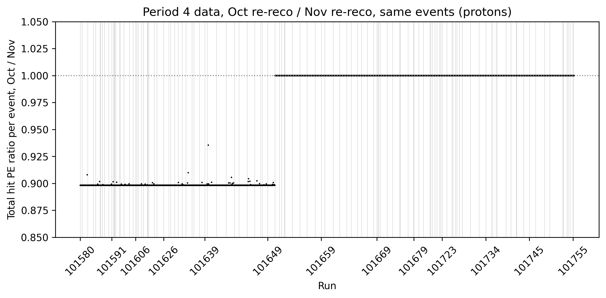
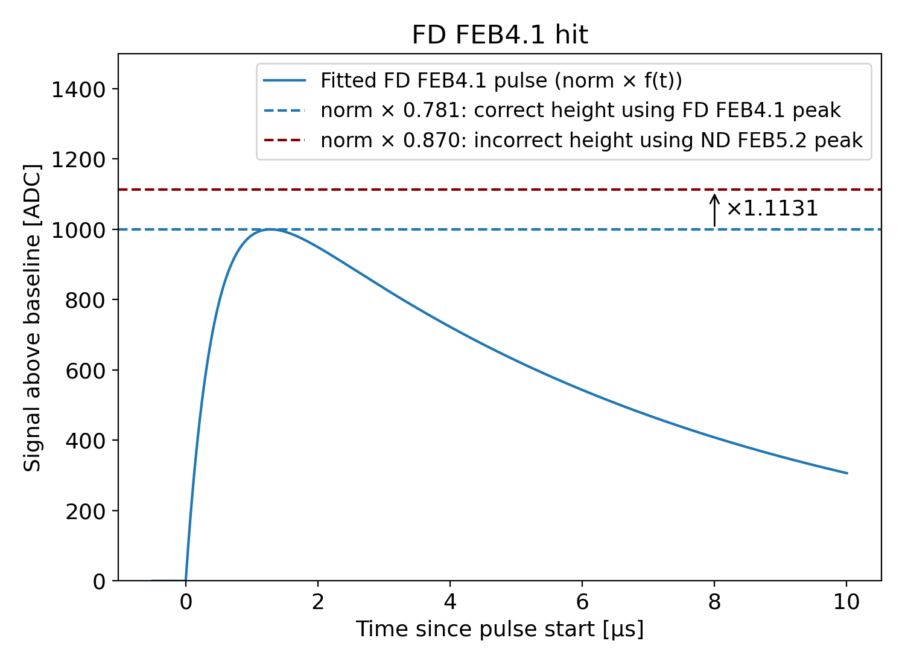
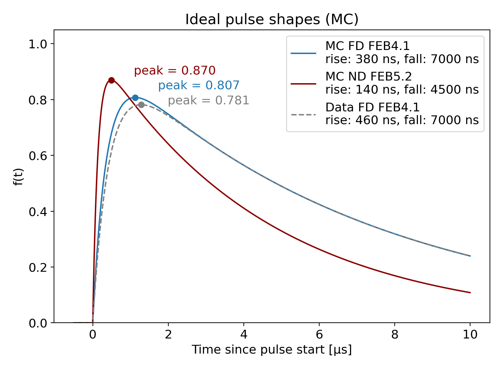

# ADC peak bug

## The problem: reco run at different times gave different PE per hit levels for the same data

**Production reco / re-reco done locally last week:**


**Re-reco done locally in Oct / Re-reco done locally last week:**


1. Production "reco"
	* Run in many jobs so I think that's what's resulted in a mixture of high and low PE levels throughout the period (4) of data
2. Locally run "re-reco": more files per job
	* Resulted in blocks of high and low PE levels throughout the period of data

---

## ADC --> PE
1. ADC samples of a hit are fitted with the "ideal pulse shape" $$f(t) = e^{-t/fall} \times (1-e^{-t/rise}) $$ which gives the pulse start time and an amplitude scale `norm`
2. Pulse height = `norm * peak`, where `peak` is the maximum of f(t) and depends only on the rise and fall times 
	* This means the `peak` value is FEB specific
	* We have two FEB types (ND and FD), so two `peak` values
3. PE = pulse height / (ADC per PE)

**Ideal pulse shapes for both FEB types:**


**Fake ADC signals to show how the pulse heights would be too high or too low if the wrong `peak` was used:**



* 0.8984 factor is the exact ones I found when taking the ratio of PE per hit between reco processings of the same events
* Same events mean the `norm` values are the same, so they cancel, just leaving the ratio of the `peak` values

## The bug

[Calibrator/func/ADCShapeFit.cxx](
https://github.com/novaexperiment/novasoft/blob/4f7234fc0ae972a953b038b2c5740b633ae55772/Calibrator/func/ADCShapeFit.cxx#L347)
* The `peak` value is computed once the first successful fit is done on a hit 
* `peak` is declared as `static` , so it is only run **once per job**
	* I assume this was done as it's redundant for FD and ND data to keep re-computing it
```
static const double peak = pow(riseTime/(riseTime+fallTime), riseTime/fallTime)-
pow(riseTime/(riseTime+fallTime), 1+riseTime/fallTime);
```

* If the job's first good-fit hit is on an FD-type FEB then FD-type hits in that job have the right light level, and ND-type hits have a too-low light level (0.8984 factor)
* If the job's first good-fit hit is on ND-type then ND-type hits are correct, and FD-type hits have a too-high light level (1.1131 factor)
* In most cases the first good-fit hit is in a ND-type FEB, even though most FEBs are FD-type (I don't understand why this happens yet - need to read more code). This combination gives the biggest[...] 

Looks like they were very close to getting it right for Test Beam [GetExpectations](https://github.com/novaexperiment/novasoft/blob/4f7234fc0ae972a953b038b2c5740b633ae55772/Calibrator/func/ADCShap[...]

---

## The events not at the "low" ratio

* There are a small number that aren't exactly at 0.8984
* Need to dig into this still, but I expect the explanation is that these are hits that don't get a good pulse fit so the scaling isn't applied [see here](https://github.com/novaexperiment/novasoft)
* See "flip the peak test" part 2 below


---

## Testing

Added to `Calibrator/func/ADCShapeFit.cxx`
* Calculate the peak value for each fit `own_peak`
* Printout whether the hit was in a ND-type `fIsND 1` or FD-type `fisND 0` FEB
* Printout the peak value for the fit `own_peak` (the value that should have been used)
* Printout the peak value actually used `static_peak`

SORRY the printout is confusing it says `"peak_used: fIsND " << fIsND` but it's not the "peak used", it's the FEB-type the hit was in. I will write notes in comments etc. where needed to make this[...]

```
NOvA SL7> git diff Calibrator/func/ADCShapeFit.cxx 

diff --git a/Calibrator/func/ADCShapeFit.cxx b/Calibrator/func/ADCShapeFit.cxx

index a17be555db..1ca1b2ab7d 100644

--- a/Calibrator/func/ADCShapeFit.cxx

+++ b/Calibrator/func/ADCShapeFit.cxx

@@ -346,7 +346,12 @@ namespace calib

      // Analytic calculation from the functional form in ReadoutSim

      static const double peak = pow(riseTime/(riseTime+fallTime), riseTime/fallTime)-

         pow(riseTime/(riseTime+fallTime), 1+riseTime/fallTime);

-      

+      // peak_used: debug printout, do not commit

+      const double own_peak = pow(riseTime/(riseTime+fallTime), riseTime/fallTime)-

+        pow(riseTime/(riseTime+fallTime), 1+riseTime/fallTime);

+      std::cout << "peak_used: fIsND " << fIsND # SORRY this is printing out which FEB-type the hit was actually in, not the "peak used"

+                << " own_peak " << own_peak # this is the peak that should be used for the FEB-type the hit was in

+                << " static_peak " << peak << std::endl; # this is the peak that is used    

      adcpeak = norm*peak;

     }

     else{

NOvA SL7>
```

This printouts for every good-fit hit so it helped to see what's happening, but use some grep commands to turn it into something more usable...

1. `grep -m 1 peak_used <log-file>`
* Printouts only the first matching line (`-m 1` = stop after 1 match)

2. `grep peak_used <log-file> | sort | uniq -c`
* `sort` puts identical lines next to eachother
* `uniq -c` collapses each identical line group and gives a count for each

For a job that processed 4 events:

```
grep -m 1 peak_used /exp/nova/app/users/ebannist/TBPeakDebug-logs/log-t13-peakused-n10.txt

# read these as "info on the peak used: the hit was in a ND-type FEB, the peak that should have been used was: <x>, the peak that was used was: <y>"

peak_used: fIsND 1 own_peak 0.869748 static_peak 0.869748

grep peak_used /exp/nova/app/users/ebannist/TBPeakDebug-logs/log-t13-peakused-n10.txt | sort | uniq -c

  6278 peak_used: fIsND 0 own_peak 0.781351 static_peak 0.869748
   784 peak_used: fIsND 1 own_peak 0.869748 static_peak 0.869748
```
* Reminder:
	*  FD has the lower `peak` of ~0.78, and ND has the higher peak of ~0.87
* This tells us that 6278/7062 (89%) of the fits were on FD-type hits, but all had the ND-type peak value used - the same as the first peak in the job

3. `grep -E "Begin processing|peak_used" <log-file> | awk '{print $1, $2, $3}' | uniq -c` 
   * `-E` (`--extended-regexp`) option, `grep` uses extended regular expressions where `|` does not need to be escaped
   * Keep the Begin processing line that prints at start of every event, and the printout lines
   * `awk '{print $1, $2, $3}'` keeps only the first 3 words (which gives the FEB type) 
   * This time no `sort` so `uniq -c` collapses only consequetive identical lines so you can see the order of the ND-type and FD-type hits within each event

###  flip the peak test

Part 1:
* From the above printout, the 6th event in the job has a first good-fit hit in an FD-type FEB
* So running the same job but with `--nskip 5 -n 1` I should see the `peak_used` change to the FD peak value

Part 2:
* Comparing the same event across the two jobs, hit by hit
* This event has been reco'd twice
1. In a job with ND-type peak
2. In a job with FD-type peak

Reminder:
* The ND-type FEBs are on planes 16, 17, 48 and 49 ([TB calibration tech note 60592-v3](https://nova-docdb.fnal.gov/cgi-bin/sso/ShowDocument?docid=60592))

Ratio = flip job PE / 5-file job PE
* flip job has the FD-type peak, 5-file job has the ND-type peak

| Hits |Count | Ratio | Explanation   |
|---|---|---|---|
|FD FEB planes, good-fit hits|52|0.8984|PE correct in the flip job, PE 1.1131 too high in the 5-file job|
|ND FEB planes, good-fit hits|10|0.8984|PE 0.8984 too low in the flip job, PE correct in the 5-file job|
|Hit #42 |1|1.0000|Never uses `peak` as the fit failed|

* The hit with unchanged PE between jobs was in plane 25, cell 30 with 45.04 PE (hit #42)

Examples of single hits:
```
A FD HIT #9:
job       peak            Plane    Cell   PE
"flip"    FD (correct)    27 (FD)  23     804.86053
"5-file"  ND (incorrect)  27 (FD)  23     895.91735
# PE ratio = 804.86053 / 895.91735 = 0.8983647096

A ND HIT #59
job       peak            Plane    Cell   PE
"flip"    FD (incorrect)  16 (ND)  31     814.95782
"5-file"  ND (correct)    16 (ND)  31     907.15704
# PE ratio = 814.95782 / 907.15704 = 0.8983646536
```

The ratio is 0.8984 for every good-fit hit where the peak values are different. It would be possible to work out what the peak value for each job is by taking the ratio with a processing that we [...]

---

## Next steps

* Fix the bug, and then re-run reco on some of the data, then make plots etc.
* Fix for sim as well.
* I also noticed the the sim FD-type rise time is [380 ns](https://github.com/novaexperiment/novasoft/blob/a384dbc38d9d18feb3dfdae028770b39fa8b7daa/Calibrator/func/ADCShapeFit.cxx#L278) whereas i[...]
* Once we're sure, share with whoever needs to know :scream:
* Fix and run reco again on all periods of data
* Make sim


### Sim thing


