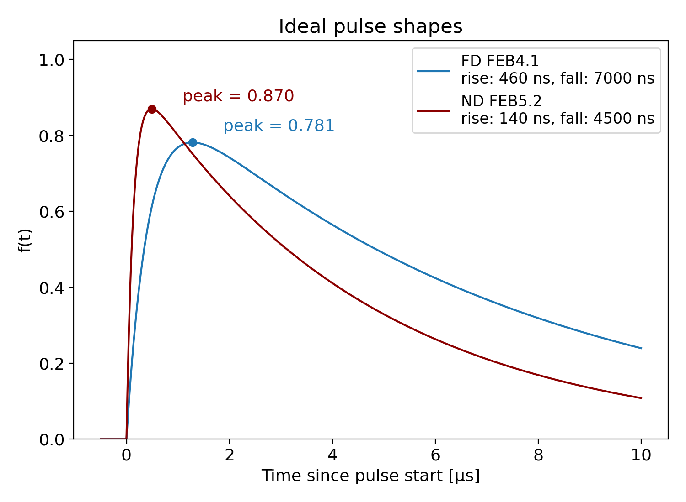
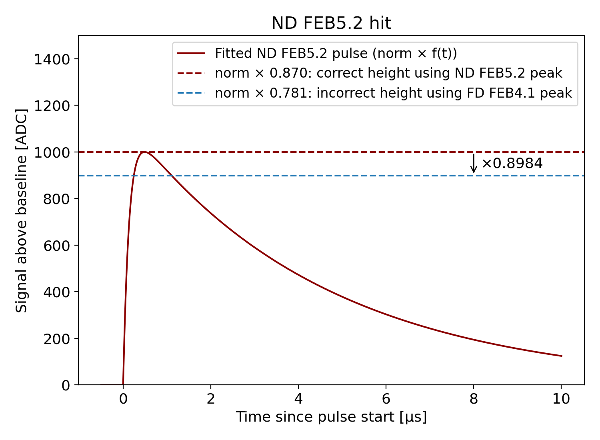
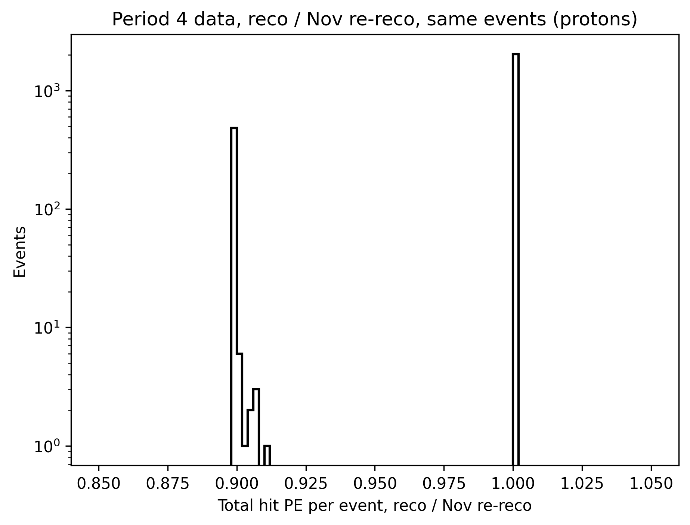

# ADC peak bug

## The problem: reco run at different times gave different PE per hit levels for the same data

**Production reco / re-reco done locally last week:**


**Re-reco done locally in Oct / Re-reco done locally last week:**


1. Production "reco"
	* Run in many jobs so I think that's what's resulted in a mixture of high and low PE levels throughout the period (4) of data
2. Locally run "re-reco": more files per job
	* Resulted in blocks of high and low PE levels throughout the period of data

---

## ADC --> PE
1. ADC samples of a hit are fitted with the "ideal pulse shape" $$f(t) = e^{-t/fall} \times (1-e^{-t/rise}) $$ which gives the pulse start time and an amplitude scale `norm`
2. Pulse height = `norm * peak`, where `peak` is the maximum of f(t) and depends only on the rise and fall times 
	* This means the `peak` value is FEB specific
	* We have two FEB types (ND and FD), so two `peak` values
3. PE = pulse height / (ADC per PE)

**Ideal pulse shapes for both FEB types:**


**Fake ADC signals to show how the pulse heights would be too high or too low if the wrong `peak` was used:**



* 0.8984 factor is the exact ones I found when taking the ratio of PE per hit between reco processings of the same events
* Same events mean the `norm` values are the same, so they cancel, just leaving the ratio of the `peak` values

## The bug

[Calibrator/func/ADCShapeFit.cxx](
https://github.com/novaexperiment/novasoft/blob/4f7234fc0ae972a953b038b2c5740b633ae55772/Calibrator/func/ADCShapeFit.cxx#L347)
* The `peak` value is computed once the first successful fit is done on a hit 
* `peak` is declared as `static` , so it is only run **once per job**
	* I assume this was done as it's redundant for FD and ND data to keep re-computing it
```
static const double peak = pow(riseTime/(riseTime+fallTime), riseTime/fallTime)-
	pow(riseTime/(riseTime+fallTime), 1+riseTime/fallTime);
```

* If the job's first good-fit hit is on an FD-type FEB then FD-type hits in that job have the right light level, and ND-type hits have a too-low light level (0.8984 factor)
* If the job's first good-fit hit is on ND-type then ND-type hits are correct, and FD-type hits have a too-high light level (1.1131 factor)
* In most cases the first good-fit hit is in a ND-type FEB, even though most FEBs are FD-type (I don't understand why this happens yet - need to read more code). This combination gives the biggest effect on energy as the majority of hits are FD but with a ND scaling (too high).

Looks like they were very close to getting it right for Test Beam [GetExpectations](https://github.com/novaexperiment/novasoft/blob/4f7234fc0ae972a953b038b2c5740b633ae55772/Calibrator/func/ADCShapeFit.cxx#L72), the same thing was needed for `peak` :-(

---

## The events not at the "low" ratio

* There are a small number that aren't exactly at 0.8984
* Need to dig into this still, but I expect the explanation is that these are hits that don't get a good pulse fit so the scaling isn't applied [see here](https://github.com/novaexperiment/novasoft/blob/a384dbc38d9d18feb3dfdae028770b39fa8b7daa/Calibrator/func/ADCShapeFit.cxx#L353)
* See "flip the peak test" part 2 below




---

## Testing

Added to `Calibrator/func/ADCShapeFit.cxx`
* Calculate the peak value for each fit `own_peak`
* Printout whether the hit was in a ND-type `fIsND 1` or FD-type `fisND 0` FEB
* Printout the peak value for the fit `own_peak` (the value that should have been used)
* Printout the peak value actually used `static_peak`

SORRY the printout is confusing it says `"peak_used: fIsND " << fIsND` but it's not the "peak used", it's the FEB-type the hit was in. I will write notes in comments etc. where needed to make this clear. 

```
NOvA SL7> git diff Calibrator/func/ADCShapeFit.cxx 

diff --git a/Calibrator/func/ADCShapeFit.cxx b/Calibrator/func/ADCShapeFit.cxx

index a17be555db..1ca1b2ab7d 100644

--- a/Calibrator/func/ADCShapeFit.cxx

+++ b/Calibrator/func/ADCShapeFit.cxx

@@ -346,7 +346,12 @@ namespace calib

       // Analytic calculation from the functional form in ReadoutSim

       static const double peak = pow(riseTime/(riseTime+fallTime), riseTime/fallTime)-

        pow(riseTime/(riseTime+fallTime), 1+riseTime/fallTime);

-      

+      // peak_used: debug printout, do not commit

+      const double own_peak = pow(riseTime/(riseTime+fallTime), riseTime/fallTime)-

+        pow(riseTime/(riseTime+fallTime), 1+riseTime/fallTime);

+      std::cout << "peak_used: fIsND " << fIsND # SORRY this is printing out which FEB-type the hit was actually in, not the "peak used"

+                << " own_peak " << own_peak # this is the peak that should be used for the FEB-type the hit was in

+                << " static_peak " << peak << std::endl; # this is the peak that is used    

       adcpeak = norm*peak;

     }

     else{

NOvA SL7>
```

This printouts for every good-fit hit so it helped to see what's happening, but use some grep commands to turn it into something more usable...

1. `grep -m 1 peak_used <log-file>`
* Printouts only the first matching line (`-m 1` = stop after 1 match)

2. `grep peak_used <log-file> | sort | uniq -c`
* `sort` puts identical lines next to eachother
* `uniq -c` collapses each identical line group and gives a count for each

For a job that processed 4 events:

```
grep -m 1 peak_used /exp/nova/app/users/ebannist/TBPeakDebug-logs/log-t13-peakused-n10.txt

# read these as "info on the peak used: the hit was in a ND-type FEB, the peak that should have been used was: <x>, the peak that was used was: <y>"

peak_used: fIsND 1 own_peak 0.869748 static_peak 0.869748

grep peak_used /exp/nova/app/users/ebannist/TBPeakDebug-logs/log-t13-peakused-n10.txt | sort | uniq -c

   6278 peak_used: fIsND 0 own_peak 0.781351 static_peak 0.869748
    784 peak_used: fIsND 1 own_peak 0.869748 static_peak 0.869748
```
* Reminder:
	*  FD has the lower `peak` of ~0.78, and ND has the higher peak of ~0.87
* This tells us that 6278/7062 (89%) of the fits were on FD-type hits, but all had the ND-type peak value used - the same as the first peak in the job

3. `grep -E "Begin processing|peak_used" <log-file> | awk '{print $1, $2, $3}' | uniq -c` 
   * `-E` (`--extended-regexp`) option, `grep` uses extended regular expressions where `|` does not need to be escaped ([linuxize](https://linuxize.com/post/regular-expressions-in-grep/#alternation))
   * Keep the Begin processing line that prints at start of every event, and the printout lines
   * `awk '{print $1, $2, $3}'` keeps only the first 3 words (which gives the FEB type) 
   * This time no `sort` so `uniq -c` collapses only consequetive identical lines so you can see the order of the ND-type and FD-type hits within each event
```
grep -E "Begin processing|peak_used" /exp/nova/app/users/ebannist/TBPeakDebug-logs/log-t13-peakused-n10.txt | awk '{print $1, $2, $3}' | uniq -c

# I have manually deleted all of the "peak_used" because they are misleading in these printouts
      1 Begin processing the
     43 fIsND 1
    592 fIsND 0

      1 Begin processing the
    466 fIsND 1
   4109 fIsND 0
   
      1 Begin processing the
    158 fIsND 1
    703 fIsND 0

      1 Begin processing the
    117 fIsND 1
    874 fIsND 0
```
* This tells us that the ND-type hits are fitted first and in a block, then the FD hits are fitted after

* Testing this on a larger job (run over 5 files):
	* The hits are always processed in blocks
	* When FD is the first hit, all FD hits are processed first, then the ND hits
```
grep -E "Begin processing|peak_used" /exp/nova/app/users/ebannist/TBPeakDebug-logs/log-t13-peakused-first5.txt | awk '{print $1, $2, $3}' | uniq -c

# I have manually deleted all of the "peak_used" because they are misleading in these printouts

      1 Begin processing the
     43 fIsND 1
    592 fIsND 0

      1 Begin processing the
    466 fIsND 1
   4109 fIsND 0

      1 Begin processing the
    158 fIsND 1
    703 fIsND 0

      1 Begin processing the
    117 fIsND 1
    874 fIsND 0

      1 Begin processing the
     77 fIsND 1
    470 fIsND 0

      1 Begin processing the
     52 fIsND 0              # HERE'S ONE WITH A FIRST FD-TYPE GOOD-FIT HIT!
     10 fIsND 1

      1 Begin processing the
     62 fIsND 1
    920 fIsND 0

       ....
       
       ....
       
```

###  flip the peak test

Part 1:
* From the above printout, the 6th event in the job has a first good-fit hit in an FD-type FEB
* So running the same job but with `--nskip 5 -n 1` I should see the `peak_used` change to the FD peak value
```
grep peak_used /exp/nova/app/users/ebannist/TBPeakDebug-logs/log-t13-peakused-flip-ev7922.txt | sort | uniq -c

# read these as "info on the peak used: the hit was in a ND-type FEB, the peak that should have been used was: <x>, the peak that was used was: <y>"

     52 peak_used: fIsND 0 own_peak 0.781351 static_peak 0.781351
     10 peak_used: fIsND 1 own_peak 0.869748 static_peak 0.781351
```
* Now for the same event, the peak value used is the FD-type one for both FD and ND hits

Part 2:
* Comparing the same event across the two jobs, hit by hit
* This event has been reco'd twice
1. In a job with ND-type peak
2. In a job with FD-type peak

```
# open the reco file for the "flip test" job
root -l /exp/nova/data/users/ebannist/TBPeakDebug/t13-peakused-flip-ev7922.root

# print the whole scan without pausing every 25 rows
Events->SetScanField(0)

# Events->Scan("<Columns:>plane:cell:PE", "<selection:>the FD-type event number>)
Events->Scan("rb::CellHits_calhit__TBReReco.obj.fPlane:rb::CellHits_calhit__TBReReco.obj.fCell:rb::CellHits_calhit__TBReReco.obj.fPE", "EventAuxiliary.id_.event_==7922")

# output:
***********************************************************
*    Row   * Instance * rb::CellH * rb::CellH * rb::CellH *
***********************************************************
*        0 *        0 *        33 *         1 * 34.568141 *
*        0 *        1 *        53 *        39 * 26.620245 *
*        0 *        2 *        53 *        62 * 23.242548 *
*        0 *        3 *         1 *        28 * 194.55146 *
*        0 *        4 *         3 *        29 * 188.80247 *
*        0 *        5 *         5 *        28 * 235.58169 *
*        0 *        6 *         7 *        29 * 179.54364 *
*        0 *        7 *         9 *        29 * 60.109943 *
*        0 *        8 *        11 *        29 * 253.52002 *
*        0 *        9 *        27 *        23 * 804.86053 *
*        0 *       10 *         0 *        28 * 136.48750 *
*        0 *       11 *         2 *        29 * 209.54380 *
*        0 *       12 *         6 *        29 * 110.27601 *
*        0 *       13 *        10 *        28 * 39.393737 *
*        0 *       14 *        20 *        26 * 334.87515 *
*        0 *       15 *        26 *        24 * 405.96447 *
*        0 *       16 *        24 *        53 * 51.884044 *
*        0 *       17 *        13 *        29 * 137.59330 *
*        0 *       18 *        13 *        23 * 82.883033 *
*        0 *       19 *        15 *        30 * 241.13365 *
*        0 *       20 *        15 *        28 * 128.38363 *
*        0 *       21 *        19 *        30 * 75.748107 *
*        0 *       22 *        19 *        29 * 249.71780 *
*        0 *       23 *        23 *        31 * 565.29229 *
*        0 *       24 *        23 *        26 * 241.77777 *
*        0 *       25 *         4 *        28 * 277.57882 *
*        0 *       26 *         4 *        29 * 104.67937 *
*        0 *       27 *         8 *        29 * 28.114730 *
*        0 *       28 *         8 *        28 * 310.55627 *
*        0 *       29 *        14 *        26 * 114.97724 *
*        0 *       30 *        14 *        29 * 380.88763 *
*        0 *       31 *        18 *        27 * 90.093544 *
*        0 *       32 *        18 *        28 * 82.688278 *
*        0 *       33 *        24 *        25 * 589.95929 *
*        0 *       34 *        24 *        11 * 86.511413 *
*        0 *       35 *        28 *        24 * 142.23172 *
*        0 *       36 *        28 *        23 * 587.84509 
*        0 *       37 *        21 *        30 * 111.47628 *
*        0 *       38 *        21 *        27 * 111.01805 *
*        0 *       39 *        21 *        28 * 199.73323 *
*        0 *       40 *        25 *        25 * 109.80125 *
*        0 *       41 *        25 *        24 * 253.45025 *
*        0 *       42 *        25 *        30 * 45.042736 *
*        0 *       43 *        22 *        16 * 246.36917 *
*        0 *       44 *        22 *        15 * 222.48208 *
*        0 *       45 *        22 *        17 * 236.81970 *
*        0 *       46 *        22 *        26 * 451.63851 *
*        0 *       47 *        12 *        24 * 50.371284 *
*        0 *       48 *        22 *        24 * 36.397583 *
*        0 *       49 *        10 *        61 * 26.558889 *
*        0 *       50 *        12 *        61 * 36.758670 *
*        0 *       51 *         3 *        60 * 97.577423 *
*        0 *       52 *         9 *        19 *   22.3806 *
*        0 *       53 *        48 *        47 * 208.02439 *
*        0 *       54 *        48 *        48 * 325.46810 *
*        0 *       55 *        16 *        32 * 473.41873 *
*        0 *       56 *        17 *        29 * 77.478729 *
*        0 *       57 *        16 *        31 * 19.926029 *
*        0 *       58 *        16 *        29 * 88.459968 *
*        0 *       59 *        16 *        31 * 814.95782 *
*        0 *       60 *        16 *        28 * 68.760406 *
*        0 *       61 *        16 *        30 * 490.62890 *
*        0 *       62 *        16 *        25 * 22.924657 *

***********************************************************
```

```
# repeat for the job with the ND-type peak value
root -l /exp/nova/data/users/ebannist/TBPeakDebug/t13-peakused-first5.root
Events->SetScanField(0)
Events->Scan("rb::CellHits_calhit__TBReReco.obj.fPlane:rb::CellHits_calhit__TBReReco.obj.fCell:rb::CellHits_calhit__TBReReco.obj.fPE", "EventAuxiliary.id_.event_==7922")

# output:
***********************************************************
*    Row   * Instance * rb::CellH * rb::CellH * rb::CellH *
***********************************************************
*        5 *        0 *        33 *         1 * 38.478965 *
*        5 *        1 *        53 *        39 * 29.631893 *
*        5 *        2 *        53 *        62 * 25.872064 *
*        5 *        3 *         1 *        28 * 216.56178 *
*        5 *        4 *         3 *        29 * 210.16239 *
*        5 *        5 *         5 *        28 * 262.23391 *
*        5 *        6 *         7 *        29 * 199.85607 *
*        5 *        7 *         9 *        29 * 66.910400 *
*        5 *        8 *        11 *        29 * 282.20169 *
*        5 *        9 *        27 *        23 * 895.91735 *
*        5 *       10 *         0 *        28 * 151.92884 *
*        5 *       11 *         2 *        29 * 233.25029 *
*        5 *       12 *         6 *        29 * 122.75194 *
*        5 *       13 *        10 *        28 * 43.850498 *
*        5 *       14 *        20 *        26 * 372.76080 *
*        5 *       15 *        26 *        24 * 451.89273 *
*        5 *       16 *        24 *        53 * 57.753879 *
*        5 *       17 *        13 *        29 * 153.15974 *
*        5 *       18 *        13 *        23 * 92.259895 *
*        5 *       19 *        15 *        30 * 268.41400 *
*        5 *       20 *        15 *        28 * 142.90815 *
*        5 *       21 *        19 *        30 * 84.317771 *
*        5 *       22 *        19 *        29 * 277.96929 *
*        5 *       23 *        23 *        31 * 629.24591 *
*        5 *       24 *        23 *        26 * 269.13098 *
*        5 *       25 *         4 *        28 * 308.98233 *
*        5 *       26 *         4 *        29 * 116.52214 *
*        5 *       27 *         8 *        29 * 31.295455 *
*        5 *       28 *         8 *        28 * 345.69067 *
*        5 *       29 *        14 *        26 * 127.98504 *
*        5 *       30 *        14 *        29 * 423.97885 *
*        5 *       31 *        18 *        27 * 100.28615 *
*        5 *       32 *        18 *        28 * 92.043113 *
*        5 *       33 *        24 *        25 * 656.70355 *
*        5 *       34 *        24 *        11 * 96.298774 *
*        5 *       35 *        28 *        24 * 158.32292 *
*        5 *       36 *        28 *        23 * 654.35015 *
*        5 *       37 *        21 *        30 * 124.08801 *
*        5 *       38 *        21 *        27 * 123.57795 *
*        5 *       39 *        21 *        28 * 222.32980 *
*        5 *       40 *        25 *        25 * 122.22347 *
*        5 *       41 *        25 *        24 * 282.12402 *
*        5 *       42 *        25 *        30 * 45.042736 *
*        5 *       43 *        22 *        16 * 274.24182 *
*        5 *       44 *        22 *        15 * 247.65231 *
*        5 *       45 *        22 *        17 *   263.612 *
*        5 *       46 *        22 *        26 * 502.73407 *
*        5 *       47 *        12 *        24 * 56.069976 *
*        5 *       48 *        22 *        24 * 40.515377 *
*        5 *       49 *        10 *        61 * 29.563596 *
*        5 *       50 *        12 *        61 * 40.917316 *
*        5 *       51 *         3 *        60 * 108.61672 *
*        5 *       52 *         9 *        19 * 24.912601 *
*        5 *       53 *        48 *        47 * 231.55897 *
*        5 *       54 *        48 *        48 * 362.28952 *
*        5 *       55 *        16 *        32 * 526.97833 *
*        5 *       56 *        17 *        29 * 86.244186 *
*        5 *       57 *        16 *        31 * 22.180334 *
*        5 *       58 *        16 *        29 * 98.467773 *
*        5 *       59 *        16 *        31 * 907.15704 *
*        5 *       60 *        16 *        28 * 76.539527 *
*        5 *       61 *        16 *        30 * 546.13555 *
*        5 *       62 *        16 *        25 * 25.518209 *
***********************************************************
```

Reminder:
* The ND-type FEBs are on planes 16, 17, 48 and 49 ([TB calibration tech note 60592-v3](https://nova-docdb.fnal.gov/cgi-bin/sso/ShowDocument?docid=60592))

Ratio = flip job PE / 5-file job PE
* flip job has the FD-type peak, 5-file job has the ND-type peak

| Hits |Count | Ratio | Explanation   |
|---|---|---|---|
|FD FEB planes, good-fit hits|52|0.8984|PE correct in the flip job, PE 1.1131 too high in the 5-file job|
|ND FEB planes, good-fit hits|10|0.8984|PE 0.8984 too low in the flip job, PE correct in the 5-file job|
|Hit #42 |1|1.0000|Never uses `peak` as the fit failed|

* The hit with unchanged PE between jobs was in plane 25, cell 30 with 45.04 PE (hit #42)

Examples of single hits:
```
A FD HIT #9:
job       peak            Plane    Cell   PE
"flip"    FD (correct)    27 (FD)  23     804.86053
"5-file"  ND (incorrect)  27 (FD)  23     895.91735
# PE ratio = 804.86053 / 895.91735 = 0.8983647096

A ND HIT #59
job       peak            Plane    Cell   PE
"flip"    FD (incorrect)  16 (ND)  31     814.95782
"5-file"  ND (correct)    16 (ND)  31     907.15704
# PE ratio = 814.95782 / 907.15704 = 0.8983646536
```


The ratio is 0.8984 for every good-fit hit where the peak values are different. It would be possible to work out what the peak value for each job is by taking the ratio with a processing that we know the peak value for (e.g. this Nov re-reco is all ND-type). Then we _could_ correct the PE based on the FEB-type from the plane number. However this processing wasn't all data - only Period 4.0 and 4.1 so would have to reco everything to have the base to compare with, and then would have to apply the corrections. Also we would have to identify hits which failed the fit, and not scale them. So I don't think this is a good idea, and would recommend only using reco with the bug fixed.


---

## Next steps

* Fix the bug, and then re-run reco on some of the data, then make plots etc.
* Fix for sim as well.
* I also noticed the the sim FD-type rise time is [380 ns](https://github.com/novaexperiment/novasoft/blob/a384dbc38d9d18feb3dfdae028770b39fa8b7daa/Calibrator/func/ADCShapeFit.cxx#L278) whereas it's 460 ns for data, I haven't found explanation for this yet - I wanna know!
* Once we're sure, share with whoever needs to know :scream:
* Fix and run reco again on all periods of data
* Make sim


### Sim thing


